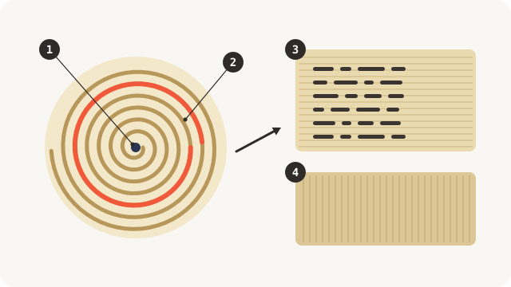

# The papyrus scroll

*One long strip of papyrus rolled onto itself: its shape drives everything else.*

## The idea

An ancient book has no pages: it is a strip of papyrus, several metres long, rolled onto itself. Seen end-on, a scroll is a spiral. Reading it means following that spiral from one end to the other.

## How it works

1. **The centre** of the scroll, around which everything is wound (the *umbilicus*).
2. **A wrap** (or winding): one full turn of the strip. A scroll has hundreds.
3. **The recto**: the written side. Its fibres run horizontally and it always faces the inside of the roll.
4. **The verso**: the back, with vertical fibres.

*Numbers refer to the plate.*

## Why it matters here

The scanner does not see "a sheet": it sees matter. Knowing that the recto faces the centre and that fibres run in two directions helps to find the sheet inside the volume (K-06). Scroll names read like this: "PHerc. 1667" is Herculaneum papyrus number 1667.
