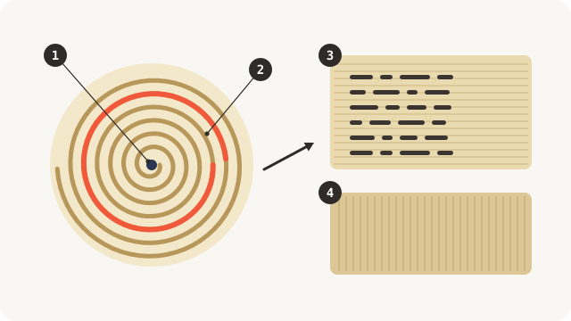

# Le rouleau de papyrus

*Une longue bande de papyrus enroulée sur elle-même : c'est sa forme qui dicte tout le reste.*

## L'idée

Un livre antique n'a pas de pages : c'est une bande de papyrus, longue de plusieurs mètres, enroulée sur elle-même. Vu par la tranche, un rouleau est une spirale. Le lire, c'est suivre cette spirale d'un bout à l'autre.

## Comment ça marche

1. **Le centre** du rouleau, autour duquel tout s'enroule (*umbilicus*).
2. **Une spire** : un tour complet de la bande. Un rouleau en compte des centaines.
3. **Le recto** : la face écrite. Ses fibres sont horizontales, et elle est toujours tournée vers l'intérieur du rouleau.
4. **Le verso** : le dos, aux fibres verticales.

*Les numéros renvoient à la planche.*

## Pourquoi ça compte ici

Le scanner ne voit pas « une feuille » : il voit de la matière. Savoir que le recto regarde vers le centre et que les fibres dessinent deux directions aide à retrouver la feuille dans le volume (K-06). Les pages désignent les rouleaux par des noms comme « PHerc. 1667 » ou « PHerc. Paris. 4 ».

## Le vocabulaire anglais

| Anglais | Français |
|---|---|
| *scroll* | rouleau |
| *wrap, winding* | spire, tour |
| *recto / verso* | face écrite / dos |
| *fiber* | fibre |
| *umbilicus* | centre du rouleau |
