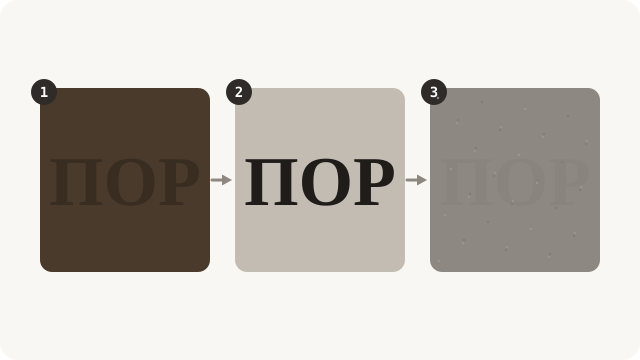

# Carbon ink

*The ink and the burnt papyrus are made of the same element: under X-rays the writing almost vanishes.*

## The idea

In 79 AD the heat of the eruption turned the scrolls into charcoal. The scribes' ink was itself carbon-based. Black ink on a blackened support: that is the whole problem.

## How it works

1. **In visible light**, on an opened fragment, the letters can barely be made out.
2. **In infrared** (around 1000 nm) they stand out clearly. But infrared cannot pass through a closed scroll.
3. **Under X-rays**, which do pass through, ink and papyrus absorb almost equally: the contrast collapses.

*Numbers refer to the plate.*

## Why it matters here

This is why ink detection exists (K-08): to recover by computation a contrast the scanner does not provide. Fragments that are already open act as an answer key, because their ink can be photographed in infrared and compared with the scan.
