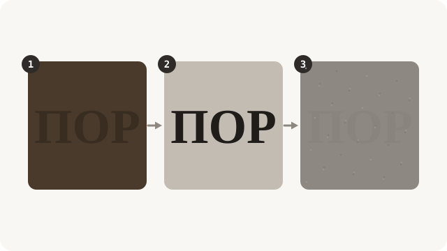

# L'encre au carbone

*L'encre et le papyrus brûlé sont faits du même élément : aux rayons X, l'écriture disparaît presque.*

## L'idée

En 79, la chaleur de l'éruption a transformé les rouleaux en charbon. L'encre des scribes était elle-même à base de carbone. Encre noire sur support noirci : c'est tout le problème.

## Comment ça marche

1. **En lumière visible**, sur un fragment ouvert, les lettres se devinent à peine.
2. **En infrarouge** (vers 1000 nm), elles ressortent nettement. Mais l'infrarouge ne traverse pas un rouleau fermé.
3. **Aux rayons X**, qui eux traversent le rouleau, l'encre et le papyrus absorbent presque autant : le contraste s'effondre.

*Les numéros renvoient à la planche.*

## Pourquoi ça compte ici

C'est la raison d'être de la détection d'encre (K-08) : retrouver par le calcul un contraste que le scanner ne donne pas. Les fragments déjà ouverts servent de corrigé, puisqu'on peut y photographier l'encre en infrarouge et la comparer au scan.

## Le vocabulaire anglais

| Anglais | Français |
|---|---|
| *carbonized* | carbonisé |
| *carbon ink* | encre au carbone |
| *infrared* | infrarouge |
| *fragment* | fragment (morceau détaché, écriture visible) |
