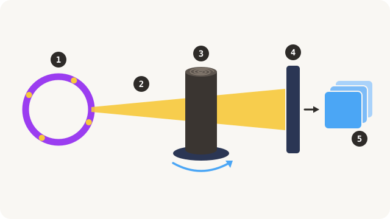

# X-ray tomography

*The scroll is X-rayed from every angle, then its inside is recomputed in 3D.*

## The idea

It is the principle of a medical CT scanner, pushed much further. Details of a few thousandths of a millimetre must be seen, which takes a very powerful X-ray source: a synchrotron.

## How it works

1. **The synchrotron**: a particle accelerator. Electrons circle in it at very high speed and emit X-rays.
2. **The beam** passes through the scroll. Each material attenuates it more or less.
3. **The scroll rotates**: hundreds to thousands of views are recorded at different angles.
4. **The detector** measures what comes out.
5. **The volume**: a computation combines all views into one 3D block (K-04).

*Numbers refer to the plate.*

## Why it matters here

Everything we do starts from these volumes, which we do not produce ourselves. The recent scans of the challenge come from ESRF in Grenoble, with voxels of about 2.4 µm. Their flaws (hazy regions, P-110) carry over into every later step.
