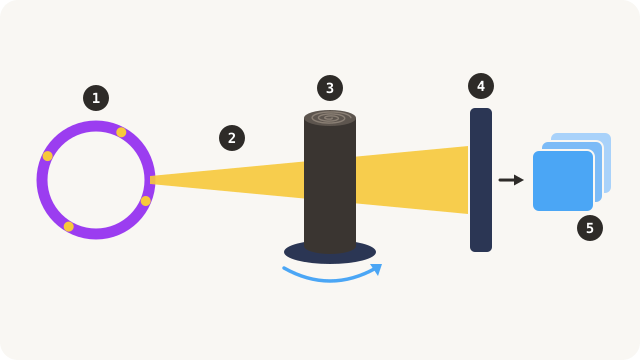

# La tomographie à rayons X

*On photographie le rouleau aux rayons X sous tous les angles, puis on recalcule son intérieur en 3D.*

## L'idée

C'est le principe du scanner médical, poussé beaucoup plus loin. Il faut voir des détails de quelques millièmes de millimètre, donc une source de rayons X très puissante : un synchrotron.

## Comment ça marche

1. **Le synchrotron** : un accélérateur de particules. Des électrons y tournent très vite et émettent des rayons X.
2. **Le faisceau** traverse le rouleau. Chaque matière l'atténue plus ou moins.
3. **Le rouleau tourne** : on enregistre des milliers de vues sous des angles différents.
4. **Le détecteur** mesure ce qui ressort.
5. **Le volume** : un calcul combine toutes les vues en un bloc 3D (K-04).

*Les numéros renvoient à la planche.*

## Pourquoi ça compte ici

Tout ce que nous ferons part de ces volumes, que nous ne produisons pas nous-mêmes. Les scans récents du défi viennent de l'ESRF, à Grenoble, avec des voxels de 2,4 µm environ. Leurs défauts (zones floues, P-110) se retrouvent dans toutes les étapes suivantes.

## Le vocabulaire anglais

| Anglais | Français |
|---|---|
| *CT, micro-CT* | tomographie |
| *beamline* | ligne de lumière |
| *attenuation* | atténuation |
| *scan volume* | volume scanné |
