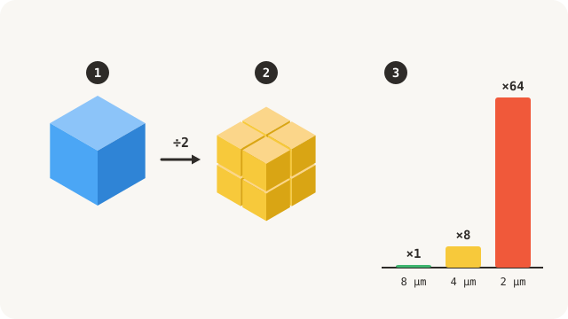

# Voxels and resolution

*A voxel is a 3D pixel. Halving its size multiplies the data by eight.*

## The idea

A scan is a grid of small cubes, the voxels, each carrying one grey value. The smaller the cubes, the more detail is visible, and the faster the file grows.

## How it works

1. **A voxel**: a cube of matter, summed up by a single number.
2. **Halving its size** gives eight cubes instead of one: twice as many along each of the three directions.
3. **In data**: going from 8 µm to 2 µm means 64 times more voxels for the same scroll.

*Numbers refer to the plate.*

## Why it matters here

A scroll scanned at high resolution weighs several terabytes. This is what forces us to read data in chunks (K-10) and to watch our video memory (P-420). One micrometre (µm) is a thousandth of a millimetre.
