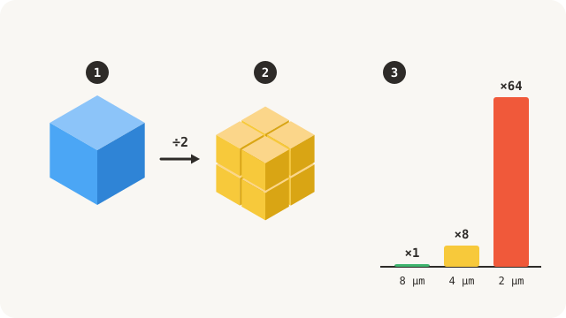

# Le voxel et la résolution

*Un voxel est un pixel en 3D. Diviser sa taille par deux multiplie les données par huit.*

## L'idée

Le scan est une grille de petits cubes, les voxels, qui portent chacun une valeur de gris. Plus les cubes sont petits, plus on voit de détails, et plus le fichier grossit, très vite.

## Comment ça marche

1. **Un voxel** : un cube de matière, résumé par un seul nombre.
2. **Diviser sa taille par deux** donne huit cubes à la place d'un : deux fois plus dans chacune des trois directions.
3. **En données** : passer de 8 µm à 2 µm, c'est environ 64 fois plus de données pour le même rouleau.

*Les numéros renvoient à la planche.*

## Pourquoi ça compte ici

Les données de scan des grands rouleaux peuvent atteindre des dizaines de téraoctets. C'est ce qui nous oblige à lire les données par morceaux (K-10) et à compter notre mémoire vidéo (P-420). Un micromètre (µm) vaut un millième de millimètre.

## Le vocabulaire anglais

| Anglais | Français |
|---|---|
| *voxel* | voxel (pixel en 3D) |
| *voxel size, resolution* | taille de voxel, résolution |
| *downscale* | réduire la résolution |
