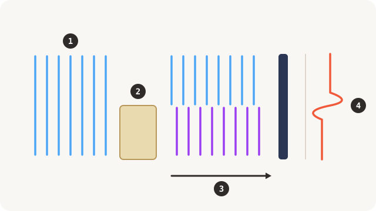

# Phase contrast

*When two materials absorb alike they can still be told apart: they do not delay the wave in the same way.*

## The idea

An X-ray is a wave. Passing through matter it is not only attenuated: it is also shifted. That shift is invisible at first and shows up if the wave is left to travel before it is measured.

## How it works

1. **The wave arrives**, well aligned.
2. **At the edge of an object**, the part that went through it picks up a slight shift.
3. **Distance is left** between object and detector: the two parts of the wave interfere.
4. **On the detector**, the edge appears outlined by a bright and dark fringe.

*Numbers refer to the plate.*

## Why it matters here

This is what makes the boundaries between papyrus layers visible, where absorption alone separates them poorly. But too much distance blurs the image instead of sharpening it: it is a scan setting, and one possible cause of the hazy regions (P-110).
