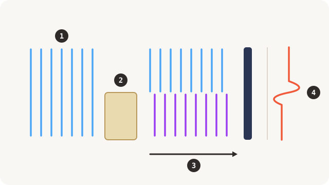

# Le contraste de phase

*Quand deux matières absorbent pareil, on peut encore les distinguer : elles ne ralentissent pas l'onde de la même façon.*

## L'idée

Un rayon X est une onde. En traversant une matière, elle n'est pas seulement atténuée : elle est aussi décalée. Ce décalage, invisible tout de suite, se révèle si on laisse l'onde voyager avant de la mesurer.

## Comment ça marche

1. **L'onde arrive**, bien alignée.
2. **Au bord d'un objet**, la partie qui l'a traversé prend un léger décalage.
3. **On laisse de la distance** entre l'objet et le détecteur : les deux parties de l'onde interfèrent.
4. **Sur le détecteur**, le bord apparaît souligné d'une frange claire et sombre.

*Les numéros renvoient à la planche.*

## Pourquoi ça compte ici

Les franges soulignent les limites entre matières : dans un objet qui offre très peu de contraste d'absorption, comme nos rouleaux, cela peut être particulièrement utile. Mais trop de distance peut brouiller l'image au lieu de la préciser : c'est un réglage du scan, et une des causes possibles des zones floues (P-110).

## Le vocabulaire anglais

| Anglais | Français |
|---|---|
| *phase contrast* | contraste de phase |
| *propagation distance* | distance de propagation |
| *fringe* | frange |
| *phase retrieval* | reconstruction de phase |
