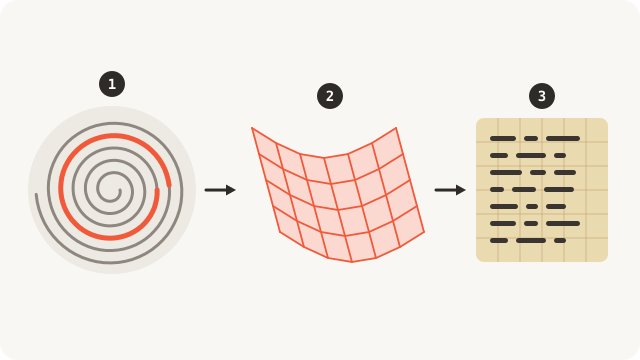

# Virtual unwrapping

*Find the sheet inside the volume, follow it, then flatten it on screen, without touching the scroll.*

## The idea

The scan gives a block of matter, not a sheet. Virtual unwrapping means finding where the sheet runs, following it step by step, then laying it flat so that writing can be looked for.

## How it works

1. **Locate**: in each slice, a model predicts where the written surface of each wrap lies.
2. **Follow**: a mesh is built, a grid of points that hugs the sheet in 3D. The resulting piece is called a segment.
3. **Flatten**: each point is given a 2D position, with as little distortion as possible.

*Numbers refer to the plate.*

## Why it matters here

This is the subject of the Grand Prize. Three errors keep coming back: holes, two neighbouring sheets merged, and a jump from one sheet to the next. A single one is enough to mix two passages of the text. We leave this area aside to begin with (D-001).
