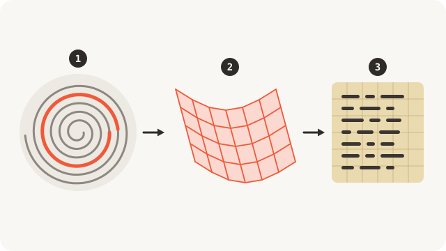

# Le dépliage virtuel

*Retrouver la feuille dans le volume, la suivre, puis l'aplatir à l'écran, sans toucher au rouleau.*

## L'idée

Le scan donne un bloc de matière, pas une feuille. Le dépliage virtuel consiste à retrouver où passe la feuille, à la suivre de proche en proche, puis à la mettre à plat pour pouvoir y chercher l'écriture.

## Comment ça marche

1. **Repérer** : un modèle prédit, pour chaque voxel du volume, la probabilité d'être sur la surface écrite (le recto).
2. **Suivre** : on construit un maillage, une grille de points qui épouse la feuille en 3D. Le morceau obtenu s'appelle un segment.
3. **Aplatir** : on donne à chaque point une position en 2D, en déformant le moins possible.

*Les numéros renvoient à la planche.*

## Pourquoi ça compte ici

Le Grand Prix 2027 récompense qui déroulera entièrement un rouleau et le rendra lisible. Trois erreurs reviennent : les trous, la fusion de deux feuilles voisines, et le saut d'une feuille à l'autre. Une petite erreur locale peut envoyer le maillage sur la mauvaise spire, sans moyen simple de revenir. Nous laissons ce domaine de côté pour commencer (D-001).

## Le vocabulaire anglais

| Anglais | Français |
|---|---|
| *virtual unwrapping* | dépliage virtuel |
| *surface prediction* | prédiction de surface |
| *mesh* | maillage |
| *segment* | segment (morceau de feuille tracé) |
| *flattening* | aplatissement |
| *sheet switch* | saut d'une feuille à l'autre |
