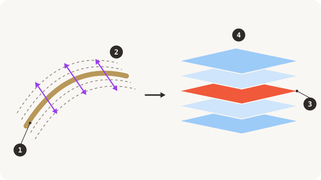

# The surface volume

*A thick slab cut around the sheet, then laid flat: this is what the ink model looks at.*

## The idea

The ink signal lies on, or near, the recovered writing surface. So a small thickness of scan is taken on both sides of the sheet and flattened with it.

## How it works

1. **The traced sheet** in the volume (the segment, K-06).
2. **The normals**: at each point, the direction perpendicular to the sheet. The scan is sampled along it, on both sides.
3. **The central layer** is the surface itself.
4. **The stack**: a few dozen flat layers, like a mille-feuille.

*Numbers refer to the plate.*

## Why it matters here

In the tutorial this is the segment's `.zarr` file: the input of the model. A slightly misplaced surface is one of the possible causes of failure listed by the team (P-320).
