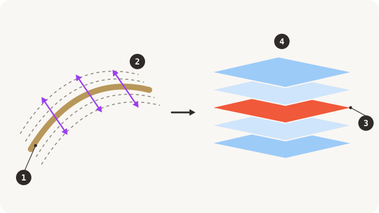

# Le volume de surface

*Une tranche épaisse découpée autour de la feuille, puis mise à plat : c'est ce que regarde le modèle d'encre.*

## L'idée

Le signal de l'encre se trouve sur la surface retrouvée, ou près d'elle. On prélève donc une petite épaisseur de scan de part et d'autre de la feuille, et on l'aplatit avec elle.

## Comment ça marche

1. **La feuille tracée** dans le volume (le segment, K-06).
2. **Les normales** : en chaque point, la direction perpendiculaire à la feuille. On échantillonne le scan le long de cette direction, de chaque côté.
3. **La couche centrale** correspond à la surface elle-même.
4. **L'empilement** : quelques dizaines de couches à plat, comme un mille-feuille.

*Les numéros renvoient à la planche.*

## Pourquoi ça compte ici

Dans le tutoriel, c'est le fichier `.zarr` du segment : l'entrée du modèle. Une surface légèrement mal placée est une des causes possibles d'échec citées par l'équipe (P-320).

## Le vocabulaire anglais

| Anglais | Français |
|---|---|
| *surface volume* | volume de surface |
| *normal* | normale (perpendiculaire) |
| *layer, slice* | couche |
| *offset* | décalage |
