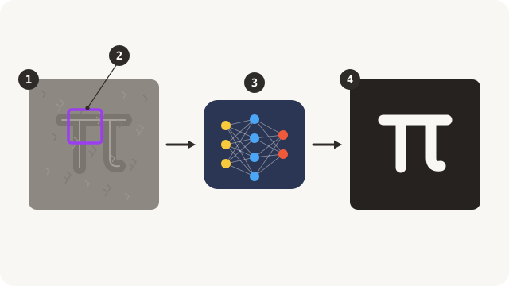

# Ink detection

*A model looks at a tiny square of scan and answers: ink or no ink. It does not read.*

## The idea

Ink leaves faint traces in the scan: a texture, a relief, sometimes a crackle like dried mud. A model learns to recognise them and paints what it believes is ink. A human then does the reading.

## How it works

1. **The input**: the surface volume (K-07), grey, where the eye sees almost nothing.
2. **The window**: the model only looks at one small square at a time, smaller than a letter. So it cannot "make up" a letter.
3. **The model**: a neural network that returns an ink probability for every pixel.
4. **The output**: all answers stitched together form an image where the writing appears.

*Numbers refer to the plate.*

## Why it matters here

This is our starting point (D-001, P-310). The model has no dictionary and no Greek alphabet: it does signal recovery. A reading only stands once papyrologists have validated it.
