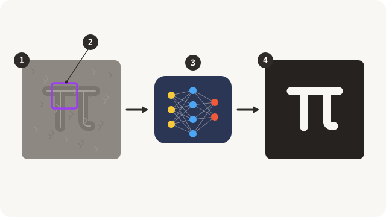

# La détection d'encre

*Un modèle regarde un tout petit carré de scan et répond : encre ou pas encre. Il ne lit pas.*

## L'idée

L'encre laisse des traces ténues dans le scan : une texture, un relief, parfois un craquelé comme de la boue sèche. Un modèle apprend à les reconnaître et colorie ce qu'il croit être de l'encre. C'est un humain qui lit ensuite.

## Comment ça marche

1. **L'entrée** : le volume de surface (K-07), gris, où l'œil ne voit presque rien.
2. **La fenêtre** : le modèle ne regarde qu'un petit carré à la fois, plus petit qu'une lettre. Il ne peut donc pas « inventer » une lettre.
3. **Le modèle** : un réseau de neurones qui rend, pour chaque pixel, une probabilité d'encre.
4. **La sortie** : toutes les réponses assemblées forment une image où l'écriture apparaît.

*Les numéros renvoient à la planche.*

## Pourquoi ça compte ici

C'est notre point de départ (D-001, P-310). Le modèle n'a ni dictionnaire ni alphabet grec : il fait de la récupération de signal. Une lecture n'est acquise qu'une fois validée par des papyrologues.

## Le vocabulaire anglais

| Anglais | Français |
|---|---|
| *ink detection* | détection d'encre |
| *crackle* | craquelé |
| *patch* | petit carré de données |
| *inference* | inférence (faire tourner le modèle) |
| *ink labels* | étiquettes d'encre |
