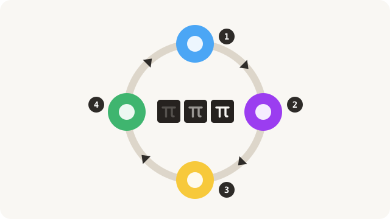

# Pseudo-labelling

*With no answer key for a closed scroll, one is built, carefully, from the model's own predictions.*

## The idea

Training a model takes corrected examples. Inside a closed scroll nobody has ever seen the ink. So progress is made by going back and forth: the model proposes, the human keeps only what is certain, and the loop starts again.

## How it works

1. **Train** a first model, for instance on opened fragments.
2. **Predict** on a segment of the closed scroll.
3. **Label** by hand, only where strokes are clearly and repeatably visible.
4. **Check** on a held-out area never shown during training, then start again.

*Numbers refer to the plate.*

## Why it matters here

This loop is how PHerc. 1667 was read. The risk is that the model learns its own mistakes: hence the caution, the control area, and the review by papyrologists. In the data, the "supervision mask" says where labels can be trusted.
