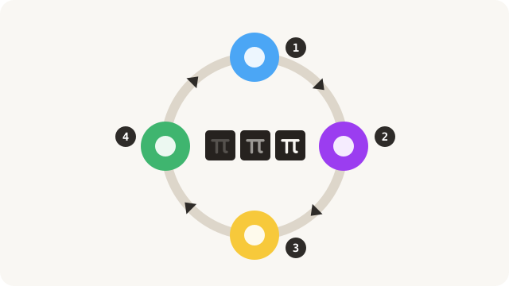

# Le pseudo-étiquetage

*Faute de corrigé pour un rouleau fermé, on s'en fabrique un, prudemment, à partir des prédictions du modèle.*

## L'idée

Pour entraîner un modèle il faut des exemples corrigés. Dans un rouleau fermé, personne n'a jamais vu l'encre. On avance donc par allers-retours : le modèle propose, l'humain ne garde que ce qui est sûr, et on recommence.

## Comment ça marche

1. **Entraîner** un premier modèle, par exemple sur des fragments ouverts.
2. **Prédire** sur un segment du rouleau fermé.
3. **Étiqueter** à la main, uniquement là où des traits de lettres sont nets et se répètent.
4. **Vérifier** sur une zone tenue à l'écart, jamais montrée pendant l'entraînement, puis recommencer.

*Les numéros renvoient à la planche.*

## Pourquoi ça compte ici

C'est par cette boucle que PHerc. 1667 a été lu. Le risque est que le modèle apprenne ses propres erreurs : d'où la prudence, la zone de contrôle, et la relecture par des papyrologues. Dans les données, le « masque de supervision » dit où les étiquettes sont fiables.

## Le vocabulaire anglais

| Anglais | Français |
|---|---|
| *pseudo-label* | pseudo-étiquette |
| *fine-tune* | réentraîner à partir d'un modèle existant |
| *held-out, validation* | tenu à l'écart, validation |
| *supervision mask* | masque de supervision |
