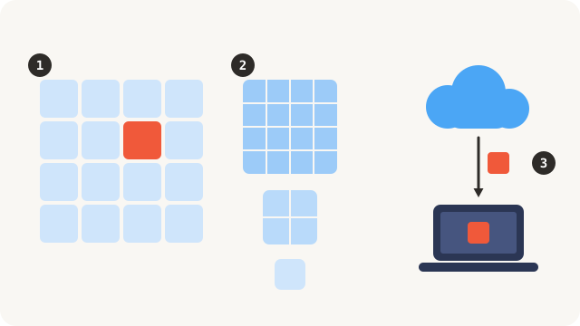

# Chunked data

*A scroll does not fit on a disk: only the small block that is needed gets downloaded.*

## The idea

The challenge volumes are stored in a cloud-friendly format, OME-Zarr. The volume is cut into small independent blocks and kept at several resolutions.

## How it works

1. **Chunks**: each one is a file. To read a region, only the chunks involved are loaded.
2. **The pyramid**: the same volume at full resolution, then halved, quartered… to look from afar without loading everything.
3. **Remote reading**: tools fetch chunks straight from the challenge's public storage.

*Numbers refer to the plate.*

## Why it matters here

This is what makes the challenge approachable with an ordinary computer. The ink tutorial downloads a single segment, about 25 GB, not the whole scroll. Any tool we write will have to read this way, in chunks, to be useful to others.
