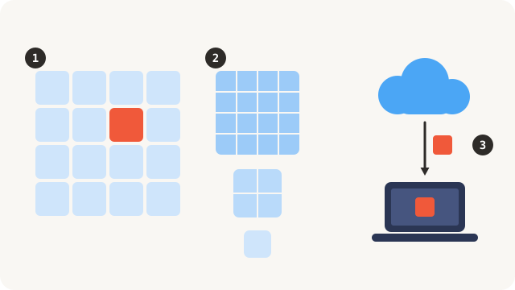

# Les données par morceaux

*Un rouleau en pleine résolution est trop gros pour être simplement téléchargé sur un portable : on ne lit que le petit bloc dont on a besoin.*

## L'idée

Les volumes du défi sont rangés dans un format pensé pour le nuage, OME-Zarr. Le volume y est découpé en petits blocs indépendants, et conservé à plusieurs résolutions.

## Comment ça marche

1. **Les blocs** (*chunks*) : pour lire une zone, on ne charge que les blocs concernés.
2. **La pyramide** : le même volume en pleine résolution, puis divisé par deux, par quatre… pour regarder de loin sans tout charger.
3. **La lecture à distance** : les outils vont chercher les blocs directement sur le stockage public du défi.

*Les numéros renvoient à la planche.*

## Pourquoi ça compte ici

C'est ce qui évite d'avoir à copier des dizaines de téraoctets chez soi, ce qui écarterait la plupart des contributeurs. Le tutoriel d'encre télécharge un seul segment, environ 25 Go, pas le rouleau entier. Tout outil que nous écrirons devra lire ainsi, par morceaux, pour être utile aux autres.

## Le vocabulaire anglais

| Anglais | Français |
|---|---|
| *chunk* | bloc, morceau |
| *OME-Zarr* | format de volumes par blocs |
| *bucket* | espace de stockage en ligne |
| *streaming* | lecture à distance au fil de l’eau |
