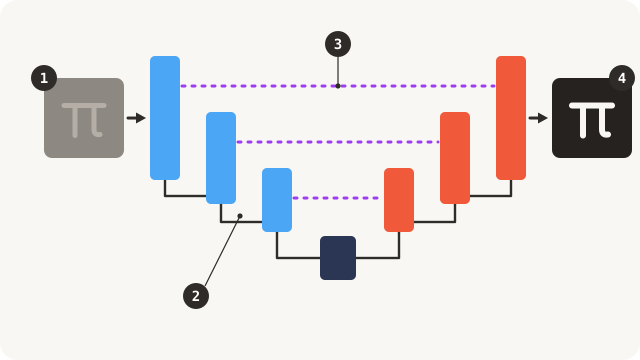

# The U-shaped network

*A network that summarises the image by shrinking it, then redraws it at full size without losing the details on the way.*

## The idea

Saying where the ink is takes both a wide view (context) and a fine answer (pixel by pixel). The U-shaped network, or U-Net, does both: one branch goes down summarising, the other goes up redrawing.

## How it works

1. **The input**: a patch of scan (K-12).
2. **The way down**: from stage to stage the patch is shrunk and described by more features, up to a ceiling. The network sees wider and wider, less and less finely.
3. **The bridges**: each stage on the way down copies its details to the stage facing it, so the way up has not lost them.
4. **The way up and the output**: the summary is unfolded stage by stage into a map of the original size, one ink value per pixel.

*Numbers refer to the plate.*

## Why it matters here

The tutorial model, `vesuvius_unet`, works in 3D. With our 128 patches it is a six-stage U, from 32 to 320 features; with the recipe's 256 patches villa builds seven stages (read in the log of the 256 trial of X-001). In X-002 the log announces it at start-up and the checkpoint lists 202,467,329 numbers for the network, but many of them appear under two names: the network has 101,938,593 distinct adjustable numbers. We touched no architecture setting, but villa configures it by itself from the patch size: by going from 256 to 128 we get one stage fewer than the tutorial recipe.
