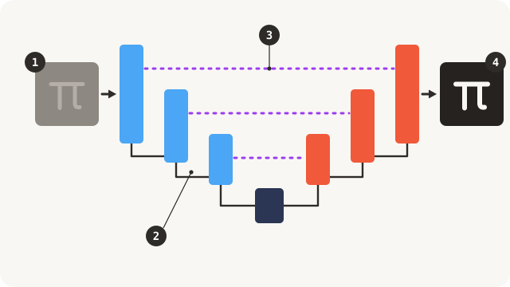

# Le réseau en U

*Un réseau qui résume l'image en la réduisant, puis la redessine à sa taille, sans perdre les détails en route.*

## L'idée

Pour dire où est l'encre, il faut à la fois voir large (le contexte) et répondre fin (pixel par pixel). Le réseau en U, ou U-Net, fait les deux : une branche descend en résumant, l'autre remonte en redessinant.

## Comment ça marche

1. **L'entrée** : un bloc de scan (K-12).
2. **La descente** : d'étage en étage, le bloc est réduit et décrit par davantage de filtres, jusqu'à un plafond. Le réseau voit de plus en plus large, de moins en moins fin.
3. **Les passerelles** : chaque étage de la descente recopie ses détails vers l'étage d'en face, pour que la remontée ne les ait pas perdus.
4. **La remontée et la sortie** : le résumé est redéployé étage par étage jusqu'à une carte de la taille d'origine, une valeur d'encre par pixel.

*Les numéros renvoient à la planche.*

## Pourquoi ça compte ici

Le modèle du tutoriel, `vesuvius_unet`, travaille en 3D. Avec nos blocs de 128, c'est un U à six étages, de 32 à 320 filtres ; avec les blocs de 256 de la recette, villa en construit sept (relevé dans le journal de l'essai à 256 de X-001). Dans X-002, le journal l'annonce au démarrage et le point de sauvegarde liste 202 467 329 nombres pour le réseau, mais beaucoup y figurent sous deux noms : le réseau compte 101 938 593 nombres réglables distincts. Nous n'avons touché à aucun réglage d'architecture, mais villa la configure seule à partir de la taille du bloc : en passant de 256 à 128, nous avons un étage de moins que la recette du tutoriel.

## Le vocabulaire anglais

| Anglais | Français |
|---|---|
| *U-Net* | réseau en U |
| *encoder, decoder* | descente, remontée |
| *skip connection* | passerelle entre les deux branches |
| *stage* | étage |
| *features* | filtres, descripteurs appris |
