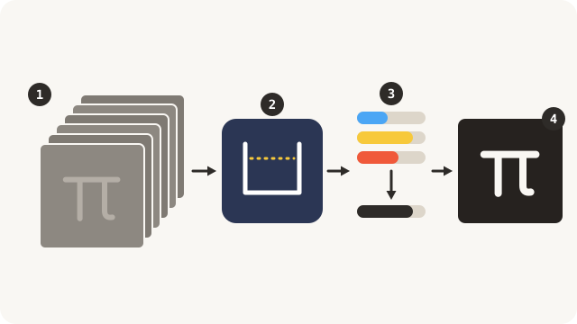

# The patch and "2.5D"

*The model takes a small 3D slab of scan and returns a flat image: it looks through the thickness and answers on the surface.*

## The idea

The ink sits on the surface of the sheet, and the surface volume stacks layers of the scan sampled around that surface. So the model looks at a thick slab, then squashes the thickness to return a flat image only. Three dimensions in, two out: hence "2.5D".

## How it works

1. **The patch**: a slab cut out of the surface volume (K-07). In the tutorial, 64 layers deep by 256 × 256 pixels; in our runs, 128 × 128.
2. **The network** processes the whole slab, in 3D (K-11).
3. **The squash**: for each pixel, only the strongest response met through the thickness is kept. This is the `z_projection_mode: max` setting.
4. **The output**: a flat image, one ink probability per pixel.

*Numbers refer to the plate.*

## Why it matters here

Patch size is the setting we changed so that training fits on our card; the tutorial also suggests reducing the batch to 1, which we have not tried. Measured in X-001: from 256 to 128 pixels a side, video memory drops from 7,996 to 4,895 MB and speed is multiplied by 66. A smaller patch sees less context; the effect on quality has not been measured. The tutorial notes that a patch is smaller than a letter, which keeps the model from "drawing" a plausible one.
