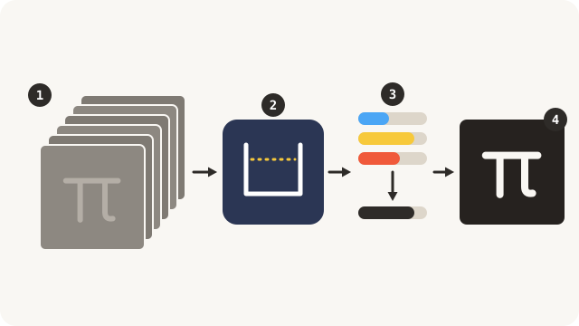

# Le bloc et le « 2,5D »

*Le modèle reçoit un petit pavé de scan en 3D et rend une image plate : il regarde en épaisseur, il répond en surface.*

## L'idée

L'encre est posée sur la feuille, mais sa trace s'étale sur quelques couches du scan. Le modèle regarde donc un pavé épais, puis écrase l'épaisseur pour ne rendre qu'une image plate. Trois dimensions en entrée, deux en sortie : d'où « 2,5D ».

## Comment ça marche

1. **Le bloc** : un pavé découpé dans le volume de surface (K-07). Dans le tutoriel, 64 couches d'épaisseur sur 256 × 256 pixels ; chez nous, 128 × 128.
2. **Le réseau** traite le pavé entier, en 3D (K-11).
3. **L'écrasement** : pour chaque pixel, on ne garde que la plus forte réponse rencontrée dans l'épaisseur. C'est le réglage `z_projection_mode: max`.
4. **La sortie** : une image plate, une probabilité d'encre par pixel.

*Les numéros renvoient à la planche.*

## Pourquoi ça compte ici

La taille du bloc est le réglage qui décide si l'entraînement tient sur notre carte. Mesuré dans X-001 : de 256 à 128 pixels de côté, la mémoire vidéo passe de 7 996 à 4 895 Mo et la vitesse est multipliée par 66. Un bloc plus petit voit moins de contexte ; l'effet sur la qualité n'est pas mesuré. Le tutoriel précise qu'un bloc est plus petit qu'une lettre, ce qui empêche le modèle d'en « dessiner » une plausible.

## Le vocabulaire anglais

| Anglais | Français |
|---|---|
| *patch* | bloc, petit pavé de données |
| *2.5D* | entrée en 3D, sortie en 2D |
| *max projection* | ne garder que le maximum sur l'épaisseur |
| *patch overlap* | recouvrement entre blocs voisins |
| *pooling factor* | facteur de réduction entre étages |
