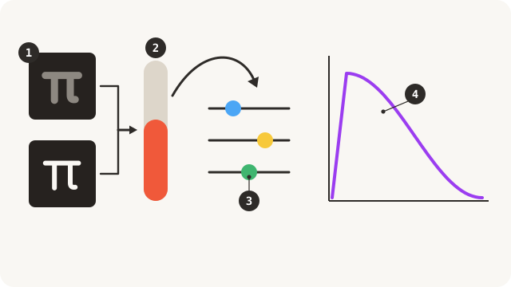

# Loss and learning rate

*Training means repeating: predict, measure the error, correct a little. The loss is that error; the learning rate is the size of the correction.*

## The idea

A fresh model answers at random. At each iteration it looks at a few patches, compares its answer with the key, and shifts its internal settings slightly in the direction that would have reduced the error. Twenty thousand times in a row.

## How it works

1. **Compare**: the model prediction (top) against the label (bottom), where the supervision mask says the label can be trusted.
2. **The loss**: the gap summed up as a single number. In villa it is the sum of a per-pixel score (BCE) and a quarter of an overlap score (Dice).
3. **The correction**: each setting of the network is nudged in the direction that lowers the loss. This is backpropagation.
4. **The learning rate**: the size of that nudge. It rises during the first 1,000 iterations, then slowly comes down to zero.

*Numbers refer to the plate.*

## Why it matters here

In X-002 the mean loss goes from 0.514 to 0.393. Three cautions when reading it: it has no telling unit (0.393 is not "39% error"); the tutorial gives no reference value; and it is measured on the training data, so it does not say what the model is worth elsewhere (K-16). The optimiser is villa's default: SGD with a momentum of 0.99.
