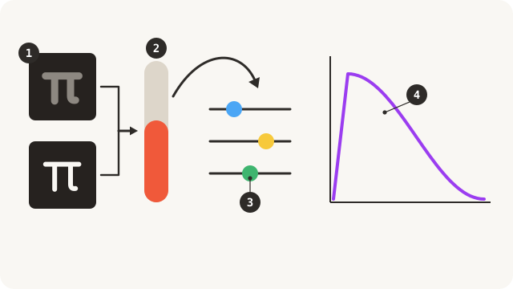

# La perte et le taux d'apprentissage

*Entraîner, c'est répéter : prédire, mesurer l'erreur, corriger un peu. La perte est cette erreur ; le taux d'apprentissage, la taille de la correction.*

## L'idée

Un modèle neuf répond au hasard. À chaque itération il regarde quelques blocs, compare sa réponse au corrigé, et déplace légèrement ses réglages internes dans le sens qui aurait réduit l'erreur. Vingt mille fois de suite.

## Comment ça marche

1. **Comparer** : la prédiction du modèle (en haut) face à l'étiquette (en bas), là où le masque de supervision dit que l'étiquette est fiable.
2. **La perte** : l'écart résumé en un seul nombre. Dans villa, c'est la somme d'une note pixel par pixel (BCE) et d'un quart d'une note de recouvrement (Dice).
3. **La correction** : chaque réglage du réseau est poussé un peu dans le sens qui fait baisser la perte. C'est la rétropropagation.
4. **Le taux d'apprentissage** : la taille de ce « un peu ». Il monte pendant les 1 000 premières itérations, puis redescend lentement jusqu'à zéro.

*Les numéros renvoient à la planche.*

## Pourquoi ça compte ici

Dans X-002, la perte moyenne passe de 0,514 à 0,393. Trois précautions pour la lire : elle n'a pas d'unité parlante (0,393 n'est pas « 39 % d'erreur ») ; le tutoriel ne donne aucune valeur de référence ; et elle est mesurée sur les données d'entraînement, donc elle ne dit pas ce que le modèle vaut ailleurs (K-16). L'optimiseur est celui de villa par défaut : SGD avec un élan de 0,99.

## Le vocabulaire anglais

| Anglais | Français |
|---|---|
| *loss* | perte |
| *iteration, step* | itération, pas |
| *batch* | lot de blocs vus ensemble |
| *learning rate* | taux d'apprentissage |
| *backpropagation* | rétropropagation |
| *warmup* | montée progressive du taux |
| *momentum* | élan |
