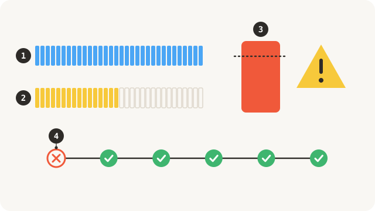

# Mixed precision

*Computing with numbers half as long wherever possible: less video memory, more speed, and a safeguard against overflow.*

## The idea

A network handles billions of numbers. Written on 16 bits instead of 32, they take half the room in the card's memory and compute faster. This is only done for operations that can bear it: hence "mixed".

## How it works

1. **32 bits**: the ordinary precision of a number.
2. **16 bits**: half the room, but a much narrower range of values.
3. **Overflow**: a value too large for 16 bits becomes infinite, and the computed correction no longer means anything.
4. **The safeguard**: when that happens, the step is skipped and the scale of the computation is lowered. Training goes on, unless overflows exceed the tolerated number during the first checked steps (four over 200 steps in our settings): villa then stops it.

*Numbers refer to the plate.*

## Why it matters here

The `mixed_precision: fp16` setting comes from the tutorial. In X-002 one overflow happened at the very first step, which was skipped, then none over the 200 checked steps. The tutorial describes this case as common and harmless. We have not measured what training would cost in 32 bits on our card.
