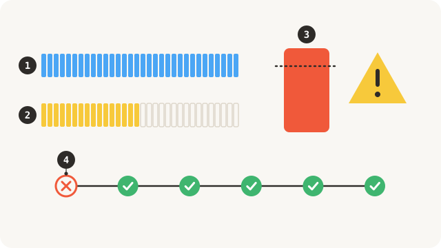

# La précision mixte

*Calculer avec des nombres deux fois plus courts là où c'est possible : moins de mémoire vidéo, plus de vitesse, et un garde-fou pour les débordements.*

## L'idée

Un réseau manipule des milliards de nombres. Écrits sur 16 bits au lieu de 32, ils prennent deux fois moins de place dans la mémoire de la carte et se calculent plus vite. On ne le fait que pour les opérations qui le supportent : d'où « mixte ».

## Comment ça marche

1. **32 bits** : la précision ordinaire d'un nombre.
2. **16 bits** : moitié moins de place, mais une plage de valeurs bien plus étroite.
3. **Le débordement** : une valeur trop grande pour 16 bits devient infinie, et la correction calculée ne veut plus rien dire.
4. **Le garde-fou** : quand cela arrive, le pas est sauté et l'échelle des calculs est réduite. L'entraînement continue, sauf si les débordements dépassent le nombre toléré pendant les premiers pas contrôlés (chez nous, quatre sur 200 pas) : villa l'arrête alors.

*Les numéros renvoient à la planche.*

## Pourquoi ça compte ici

Le réglage `mixed_precision: fp16` vient du tutoriel. Dans X-002, un débordement a eu lieu au tout premier pas, qui a été sauté, puis plus aucun sur les 200 pas contrôlés. Le tutoriel décrit ce cas comme courant et sans gravité. Nous n'avons pas mesuré ce que l'entraînement coûterait en 32 bits sur notre carte.

## Le vocabulaire anglais

| Anglais | Français |
|---|---|
| *mixed precision* | précision mixte |
| *fp16, half precision* | nombres sur 16 bits |
| *overflow* | débordement |
| *gradient* | correction calculée pour chaque réglage |
| *gradient scaler* | mise à l'échelle des corrections |
