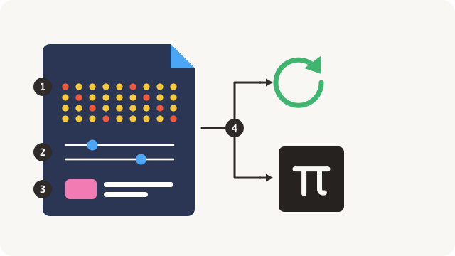

# The checkpoint

*What a training run produces: a file holding the model as it is at a given moment. Neither an image nor a reading.*

## The idea

Training a model means adjusting millions of numbers. The checkpoint is a snapshot of those numbers, written to disk at regular intervals. It is the actual result of two hours of computing.

## How it works

1. **The weights**: all the internal settings of the network. This is almost the whole file.
2. **The optimiser and scheduler state**: what is needed to resume training exactly where it stopped.
3. **The configuration and the step number**: which settings this model was trained with, and how far.
4. **Two uses**: resume training, or run the model on a segment to get an ink image (inference).

*Numbers refer to the plate.*

## Why it matters here

X-002 wrote 20 checkpoints of 816 MB, one every 1,000 iterations. The last one, `ckpt_020000.pth`, holds 202,467,329 numbers in 500 arrays. The challenge rules forbid putting weights in the repository: they stay on the machine, and what we publish is the command that produces them. The tutorial notes that a prediction can be run on an intermediate checkpoint to watch the model improve.
