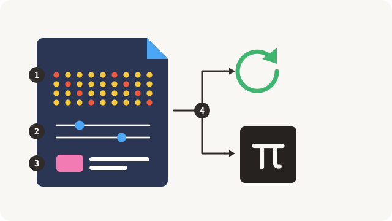

# Le point de sauvegarde

*Ce qu'un entraînement produit : un fichier qui contient le modèle tel qu'il est à un instant donné. Ni une image, ni une lecture.*

## L'idée

Entraîner un modèle, c'est ajuster des millions de nombres. Le point de sauvegarde est la photo de ces nombres, écrite sur le disque à intervalles réguliers. C'est lui, le résultat de deux heures de calcul.

## Comment ça marche

1. **Les poids** : tous les réglages internes du réseau. Dans notre fichier, c'est environ la moitié de la place ; l'autre moitié est l'état de l'optimiseur.
2. **L'état de l'optimiseur et du planificateur** : de quoi reprendre l'entraînement au pas où ce point a été écrit.
3. **La configuration et le numéro du pas** : avec quels réglages ce modèle a été entraîné, et jusqu'où.
4. **Deux usages** : reprendre l'entraînement, ou faire tourner le modèle sur un segment pour obtenir une image d'encre (l'inférence).

*Les numéros renvoient à la planche.*

## Pourquoi ça compte ici

X-002 a écrit 20 points de sauvegarde de 816 Mo, un toutes les 1 000 itérations. Le dernier, `ckpt_020000.pth`, liste pour le réseau 202 467 329 nombres en 500 tableaux, dont 101 938 593 distincts en 256 tableaux (les autres sont les mêmes sous un second nom), et autant de nombres pour l'optimiseur. Nous ne mettons aucun poids dans le dépôt (règle de ce projet, non du défi) : ils restent sur la machine, et c'est la commande qui les produit que nous publions. Le tutoriel indique, à propos de son entraînement 3D natif de dix heures, qu'on peut lancer une prédiction sur un point intermédiaire pour voir les prédictions s'améliorer.

## Le vocabulaire anglais

| Anglais | Français |
|---|---|
| *checkpoint* | point de sauvegarde |
| *weights* | poids, réglages internes du réseau |
| *inference* | inférence : faire tourner le modèle |
| *resume* | reprendre l'entraînement |
