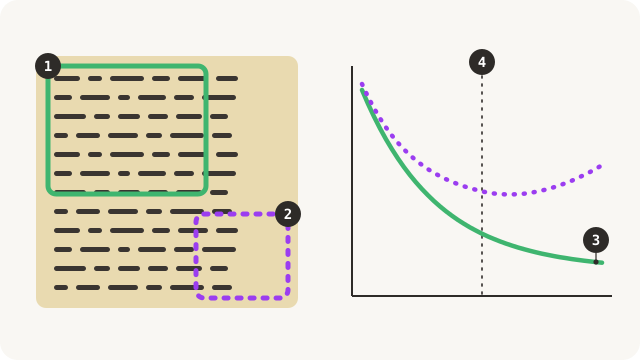

# Held-out validation

*To know whether a model has understood or merely memorised, it is tested on an area it has never seen.*

## The idea

A model can do very well on the examples it has seen and fail everywhere else. To know, the model has to be tested on data it has never seen: an area set aside and never shown during training, or another segment.

## How it works

1. **The training area**: where labels are used to correct the model.
2. **The validation area**: labelled the same way, but excluded from training. It is only used to measure.
3. **The training error** nearly always goes down: the model fits what it sees.
4. **The split**: if the validation measure stops improving while the training error keeps going down, the model is starting to memorise. This is overfitting.

*Numbers refer to the plate.*

## Why it matters here

The tutorial segment has no validation area, and the tutorial says so: this first run only reports training loss. That is why X-002 cannot tell what the model is worth. To compare two settings fairly (patches of 128 or 256), an area will have to be set aside first. When one exists, villa measures balanced accuracy on it.
