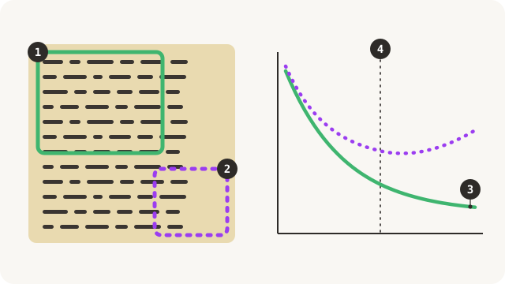

# La validation tenue à l'écart

*Pour savoir si un modèle a compris ou appris par cœur, on l'interroge sur une zone qu'il n'a jamais vue.*

## L'idée

Un modèle peut très bien réussir sur les exemples qu'il a vus et échouer partout ailleurs. La seule façon de le savoir est de garder une zone de côté, de ne jamais la lui montrer pendant l'entraînement, et de l'y interroger ensuite.

## Comment ça marche

1. **La zone d'entraînement** : là où les étiquettes servent à corriger le modèle.
2. **La zone de validation** : étiquetée de la même façon, mais exclue de l'entraînement. Elle ne sert qu'à mesurer.
3. **L'erreur d'entraînement** baisse presque toujours : le modèle s'ajuste à ce qu'il voit.
4. **Le décrochage** : si l'erreur de validation cesse de baisser pendant que l'autre continue, le modèle apprend par cœur. C'est le surapprentissage.

*Les numéros renvoient à la planche.*

## Pourquoi ça compte ici

Le segment du tutoriel n'a pas de zone de validation, et le tutoriel le dit : ce premier entraînement ne rend que la perte d'entraînement. C'est pourquoi X-002 ne permet pas de dire ce que vaut le modèle. Pour comparer honnêtement deux réglages (des blocs de 128 ou de 256), il faudra d'abord mettre une zone de côté. Quand elle existe, villa y mesure l'exactitude équilibrée.

## Le vocabulaire anglais

| Anglais | Français |
|---|---|
| *held-out* | tenu à l'écart |
| *validation mask* | masque de validation |
| *overfitting* | surapprentissage, apprentissage par cœur |
| *balanced accuracy* | exactitude équilibrée |
| *generalize* | réussir sur ce qu'on n'a pas vu |
