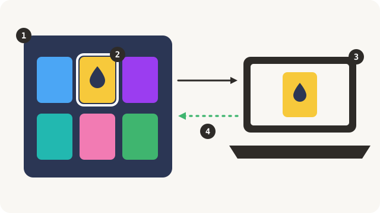

# villa, the shared repository of the challenge

*The official code of the Vesuvius Challenge, gathered in a single public repository. We use it; we did not write it.*

## The idea

The challenge publishes its tools as open source in a single GitHub repository, [ScrollPrize/villa](https://github.com/ScrollPrize/villa). It holds what each step of the work needs: unwrapping a scroll, detecting ink, looking at the result. All of it is under the MIT licence, the same as ours.

## How it works

1. **The repository**: several projects side by side in a single repository (a "monorepo"). Among its folders: `vesuvius`, `volume-cartographer` (the unwrapping tool), `segmentation`, `ink-detection`.
2. **The `vesuvius` package**: the Python library holding the ink training and prediction of the tutorial. This is the part we use.
3. **Our copy**: cloned in Ubuntu and pinned to commit `2d3fb38`, so our measurements stay reproducible even if villa changes.
4. **The way back**: an improvement is offered to the repository through a pull request. We will only offer one for a defect we actually hit, with before-and-after evidence.

*Numbers refer to the plate.*

## Why it matters here

When a run mentions "villa", that is the code actually running: our own files only hold settings and commands. X-002 thus shows what villa decides by default when our settings say nothing (the loss, the optimiser). The obstacles met while installing it are in P-410; they are possible contributions, to be checked first.
