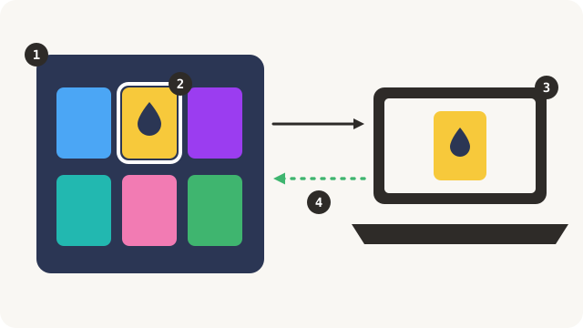

# villa, le dépôt commun du défi

*Le code officiel du Vesuvius Challenge, rassemblé dans un seul dépôt public. Nous l'utilisons ; nous ne l'avons pas écrit.*

## L'idée

Le défi publie ses outils en open source dans un dépôt GitHub unique, [ScrollPrize/villa](https://github.com/ScrollPrize/villa). On y trouve de quoi faire chaque étape du travail : déplier un rouleau, détecter l'encre, regarder le résultat. Le tout est sous licence MIT, la même que la nôtre.

## Comment ça marche

1. **Le dépôt** : plusieurs projets rangés côte à côte dans un seul dépôt (un « monorepo »). Parmi ses dossiers : `vesuvius`, `volume-cartographer` (l'outil de dépliage), `segmentation`, `ink-detection`.
2. **Le paquet `vesuvius`** : la bibliothèque Python qui contient l'entraînement et la prédiction d'encre du tutoriel. C'est la partie que nous utilisons.
3. **Notre copie** : clonée dans Ubuntu et figée au commit `2d3fb38`, pour que nos mesures restent reproductibles même si villa change.
4. **Le retour** : une amélioration se propose au dépôt par une demande de fusion. Nous n'en proposerons que pour un défaut réellement rencontré, avec la preuve avant et après.

*Les numéros renvoient à la planche.*

## Pourquoi ça compte ici

Quand une exécution cite « villa », c'est ce code-là qui tourne : nos fichiers ne contiennent que des réglages et des commandes. X-002 montre ainsi ce que villa décide par défaut quand notre réglage ne dit rien (la perte, l'optimiseur). Les obstacles rencontrés en l'installant sont dans P-410 ; ce sont des contributions possibles, à vérifier d'abord.

## Le vocabulaire anglais

| Anglais | Français |
|---|---|
| *repository* | dépôt de code |
| *monorepo* | un seul dépôt pour plusieurs projets |
| *clone* | copie locale du dépôt |
| *commit* | état daté du code, identifié par un code |
| *pull request* | demande de fusion |
| *MIT license* | licence libre très permissive |
