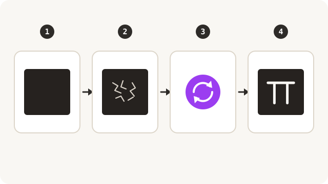

# Crackle

*The first ink seen by eye inside a closed scroll: a cracked-mud texture on the papyrus surface.*

## The idea

Herculaneum ink is almost invisible to X-rays. In August 2023 Casey Handmer nevertheless noticed, in the flattened surfaces of the first scroll, a slightly raised cracked texture that appeared to form letters. What shows is not the colour of the ink but its shape.

## How it works

1. **Look** at the raw flattened surface for a long time.
2. **Spot** the crackle: a rare cracked-mud texture sitting on the papyrus.
3. **Train** a model on those areas: each crackle found improves the model, which reveals more, sometimes invisible to the eye.
4. **Read**: letters appear. This is how Luke Farritor obtained the first word.

*Numbers refer to the plate.*

## Why it matters here

Crackle opened the way but it is an exception. In 2025 the team noted that in the two readable scrolls the signal amplified by models was either large cracks or brighter, metal-rich spots, and that models trained on these were not performing well on the other scrolls at the time. A study on opened fragments shows that surface relief alone can sometimes predict ink, not always.
