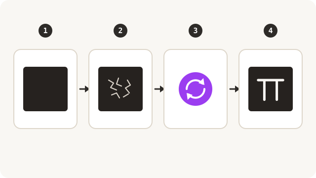

# Le craquelé

*Première encre vue à l'œil dans un rouleau fermé : une texture de boue craquelée à la surface du papyrus.*

## L'idée

L'encre d'Herculanum est presque invisible aux rayons X. En août 2023, Casey Handmer remarque pourtant, dans les surfaces aplaties du premier rouleau, une texture craquelée, légèrement en relief, qui semble former des lettres. Ce n'est pas la couleur de l'encre que l'on voit, c'est sa forme.

## Comment ça marche

1. **Regarder** longuement la surface aplatie brute, telle qu'elle sort du dépliage.
2. **Repérer** le craquelé : une texture de boue craquelée, qui semblait assez rare, posée sur le papyrus.
3. **Entraîner** un modèle sur ces zones : chaque craquelé trouvé améliore le modèle, qui en révèle d'autres, parfois invisibles à l'œil.
4. **Lire** : des lettres apparaissent. C'est ainsi que Luke Farritor obtient le premier mot.

*Les numéros renvoient à la planche.*

## Pourquoi ça compte ici

Le craquelé a ouvert la voie, mais c'est une exception. En 2025 l'équipe écrit avoir des indices que, dans les deux rouleaux lisibles, le signal amplifié par les modèles correspond soit à de grosses craquelures, soit à des points plus brillants aux rayons X, ce qui indique une plus forte concentration en métaux ; les modèles entraînés là-dessus ne donnaient alors pas de bons résultats sur les autres rouleaux. Des études sur fragments ouverts montrent que la forme de la surface porte à elle seule une information utilisable pour distinguer les zones encrées des autres ; mais l'encre n'apparaît pas toujours comme un simple relief, le signal est plus subtil et hétérogène.

## Le vocabulaire anglais

| Anglais | Français |
|---|---|
| *crackle* | le craquelé |
| *surface volume* | volume de surface (K-07) |
| *morphology* | forme, relief |
| *ink signal* | signal d'encre : ce qui distingue l'encre du papyrus dans le scan |
