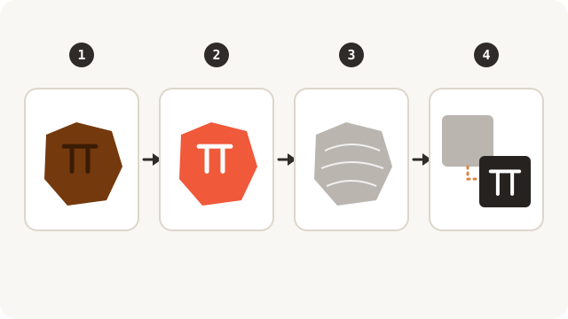

# Fragments and ground truth

*A detached piece where the ink can be seen: the place where both the scan and a photo serving as the answer key exist.*

## The idea

A fragment is a piece of scroll whose written face is exposed. It can be photographed and scanned. The photo says where the ink is; the scan is what the model will see. Together they make a corrected example: the ground truth.

## How it works

1. **The fragment**: detached from the scroll, its writing is visible.
2. **The photo**, often infrared, where ink stands out.
3. **The scan** of the same fragment, where ink can barely be told apart.
4. **Alignment** of both: for each area of the scan we know whether there is ink. This is the training pair.

*Numbers refer to the plate.*

## Why it matters here

Stephen Parsons showed on fragments that machine learning can recover ink, and the 2023 Kaggle competition used them. Two limits: these models did not seem to work on the flattened segments of a closed scroll, and a photo only gives a flat label, not the depth at which ink sits (K-22). In a closed scroll no such truth exists, hence pseudo-labelling (K-09).
