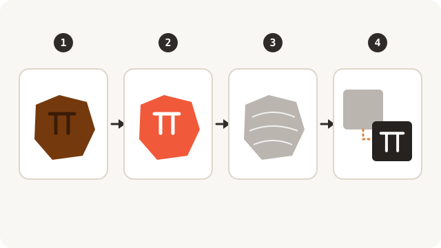

# Le fragment et la vérité terrain

*Un morceau détaché où l'on voit l'encre : le seul endroit où l'on possède à la fois le scan et le corrigé.*

## L'idée

Un fragment est un morceau de rouleau dont la face écrite est à l'air libre. On peut le photographier et le scanner. La photo dit où est l'encre ; le scan est ce que verra le modèle. Les deux ensemble forment un exemple corrigé, ce que l'anglais appelle la vérité terrain.

## Comment ça marche

1. **Le fragment** : détaché du rouleau, son écriture est visible.
2. **La photo**, souvent en infrarouge, où l'encre ressort nettement.
3. **Le scan** du même fragment, où l'encre ne se distingue presque pas.
4. **L'alignement** des deux : pour chaque zone du scan, on sait s'il y a de l'encre. C'est la paire d'entraînement.

*Les numéros renvoient à la planche.*

## Pourquoi ça compte ici

C'est sur des fragments que Stephen Parsons a montré que l'apprentissage peut retrouver l'encre, et c'est sur eux qu'a porté la compétition Kaggle de 2023. Deux limites : ces modèles ne semblaient pas marcher sur les segments aplatis d'un rouleau fermé, et la photo ne donne qu'une étiquette à plat, sans dire à quelle profondeur se trouve l'encre (K-22). Dans un rouleau fermé, cette vérité n'existe pas : d'où le pseudo-étiquetage (K-09).

## Le vocabulaire anglais

| Anglais | Français |
|---|---|
| *fragment* | fragment détaché |
| *ground truth* | vérité terrain, le corrigé |
| *infrared* | infrarouge |
| *ink label* | étiquette d'encre : image en noir et blanc alignée sur le scan |
