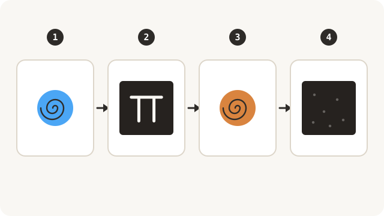

# Cross-scroll generalisation

*A model that reads one scroll may see almost nothing in another: the main bottleneck for ink.*

## The idea

Generalising means succeeding on data the model has not seen. Between two scrolls this often fails, and the challenge team writes that it sometimes has no explanation.

## How it works

1. **One scroll** is used for training.
2. **On that scroll** the model brings out letters.
3. **Another scroll**, scanned the same way.
4. **Almost nothing**: blobs, or a result that plateaus.

*Numbers refer to the plate.*

## Why it matters here

Possible causes listed by the team: the scan does not capture enough signal, the surface is slightly misplaced, labels are not where the signal is, the model relies on the wrong features, or ink morphology and chemistry differ between scrolls. There is no reliable way to tell "no ink" from "ink not recovered yet". The direction followed is models trained on several scrolls at once. The public 9 µm models are trained on four scrolls and remain sensitive to a depth offset of the surface.
