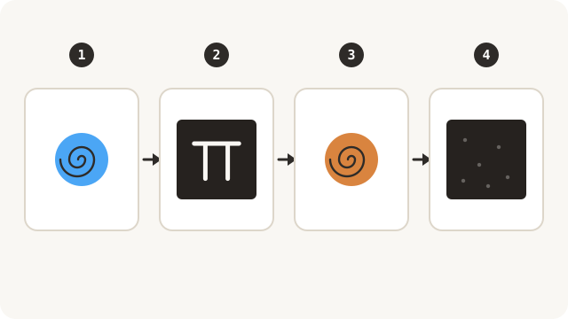

# La généralisation entre rouleaux

*Un modèle qui lit un rouleau peut ne presque rien voir dans un autre : c'est l'un des verrous que l'équipe recense pour l'encre.*

## L'idée

Généraliser, c'est réussir sur des données que le modèle n'a pas vues. Entre deux rouleaux, ce passage échoue dans certains cas, et l'équipe du défi écrit qu'elle n'a parfois aucune explication.

## Comment ça marche

1. **Un rouleau** sert à l'entraînement.
2. **Sur ce rouleau**, le modèle fait apparaître des lettres.
3. **Un autre rouleau**.
4. **Presque rien** : des taches, ou un résultat qui plafonne.

*Les numéros renvoient à la planche.*

## Pourquoi ça compte ici

Causes possibles citées par l'équipe : le scan ne capte pas assez de signal, la surface est légèrement mal placée, les étiquettes ne sont pas au bon endroit, le modèle s'appuie sur les mauvais indices, ou l'encre n'a pas la même forme ni la même chimie d'un rouleau à l'autre. On ne sait pas distinguer de façon fiable « pas d'encre » de « encre pas encore récupérée ». Ce qui aiderait, selon l'équipe : un entraînement sur plusieurs rouleaux, de meilleures étiquettes et de meilleurs diagnostics. Les modèles publics à 9 µm sont entraînés sur quatre rouleaux ; ils restent sensibles à un décalage de la surface en profondeur.

## Le vocabulaire anglais

| Anglais | Français |
|---|---|
| *generalisation* | généralisation |
| *cross-scroll model* | modèle entraîné sur plusieurs rouleaux |
| *scroll-specific model* | modèle propre à un rouleau |
| *bottleneck* | goulot, verrou |
