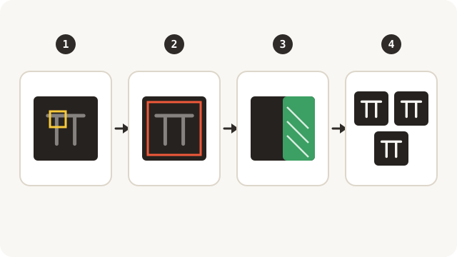

# Hallucination and window size

*A model that sees a whole letter can invent one. The challenge safeguards are there to rule that out.*

## The idea

A learning model can produce shapes resembling its training data. For ink the danger is specific: having seen Greek letters, it may draw some where there is nothing. The larger the area it looks at in one go (its window), the easier this is.

## How it works

1. **A small window**, smaller than a letter: the model can only answer "ink or not" at that spot.
2. **A large window**: it sees the whole letter and could complete it by itself.
3. **A held-out region**: never shown during training, it proves the text does not come from the model memory (K-16).
4. **Independent results** that agree on the same area, then review by papyrologists.

*Numbers refer to the plate.*

## Why it matters here

The rules changed. In 2023 and 2024 a window larger than 0.5 mm on a side was strongly discouraged (64 pixels on a side for an 8 µm scan) and could get a submission rejected. For the 2027 prizes large windows are allowed provided the text is shown not to be hallucinated. In all cases training and prediction regions must not overlap. The model is not a reader: it gets no words and no dictionary; reading stays human.
