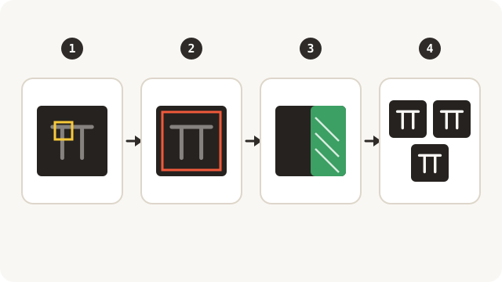

# L'hallucination et la taille de fenêtre

*Un modèle qui voit une lettre entière peut en inventer une. Les garde-fous du défi servent à l'écarter.*

## L'idée

Un modèle d'apprentissage peut fabriquer des formes qui ressemblent à ce qu'il a vu à l'entraînement. Pour l'encre, le danger est précis : s'il a vu des lettres grecques, il peut en dessiner là où il n'y a rien. Plus la zone qu'il regarde d'un coup (sa fenêtre) est grande, plus c'est facile.

## Comment ça marche

1. **Une petite fenêtre**, plus petite qu'une lettre : le modèle ne peut répondre que « encre ou pas » à cet endroit.
2. **Une grande fenêtre** : il voit la lettre entière et pourrait la compléter de lui-même.
3. **Une région tenue à l'écart** : jamais montrée à l'entraînement, elle sert à prouver que le texte ne vient pas de la mémoire du modèle (K-16).
4. **Des résultats indépendants** qui concordent sur la même zone, puis la relecture par des papyrologues.

*Les numéros renvoient à la planche.*

## Pourquoi ça compte ici

Les règles ont changé. En 2023 et 2024, une fenêtre de plus de 0,5 mm de côté était fortement déconseillée (64 pixels de côté pour un scan à 8 µm) et l'équipe pouvait alors refuser la soumission en demandant de la modifier et de la soumettre à nouveau. Pour les prix de 2027, les grandes fenêtres sont admises à condition de démontrer que le texte n'est pas inventé. Pour ces mêmes prix, les zones d'entraînement et de prédiction ne doivent pas se recouvrir. Le modèle n'est pas un lecteur : il ne reçoit ni mots ni dictionnaire, la lecture reste humaine.

## Le vocabulaire anglais

| Anglais | Français |
|---|---|
| *hallucination* | invention par le modèle |
| *window size* | taille de fenêtre |
| *held-out region* | région tenue à l'écart |
| *memorisation* | apprentissage par cœur |
