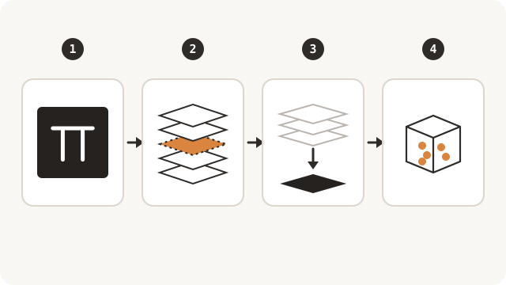

# Depth ambiguity and 3D ink

*A flat label does not say how deep the ink is. Marking ink voxel by voxel could reduce that ambiguity, when ink can be seen.*

## The idea

The scan is a volume; ink labels are images. Something is missing in between: within the thickness of the papyrus, where exactly is the signal?

## How it works

1. **The label** is flat: white where there is ink.
2. **The volume** has thickness: the ink is in one of these layers, which one is unknown.
3. **The usual setting** (2.5D, K-12): the model looks at the block as a volume, then collapses depth to return a flat image.
4. **Direct 3D segmentation**: marking ink voxel by voxel in the volume, when it is visible enough.

*Numbers refer to the plate.*

## Why it matters here

In 2026, on a 2.4 µm scan of PHerc. Paris. 4, ink is directly visible in the volume and could be segmented in 3D; projected onto the page it matches the text read in 2023. It is a cleaner target than flat labels. But the team warns that not every scroll will behave this way, that the released model is specific to this scroll, and that densely labelled 3D data is the bottleneck. A volumetric ink model, with no segmentation or flattening, had already received a prize in April 2024.
