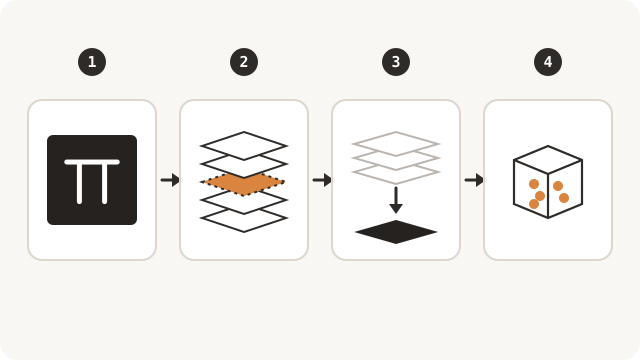

# L'ambiguïté de profondeur et l'encre en 3D

*Une étiquette à plat ne dit pas à quelle profondeur est l'encre. Marquer l'encre voxel par voxel pourrait réduire cette ambiguïté, quand on la voit.*

## L'idée

Le scan est un volume ; les étiquettes d'encre sont des images. Entre les deux, il manque une information : dans l'épaisseur du papyrus, où est exactement le signal ?

## Comment ça marche

1. **L'étiquette** est à plat : blanc là où il y a de l'encre.
2. **Le volume** a de l'épaisseur : l'encre est dans une de ces couches, on ne sait pas laquelle.
3. **Le réglage courant** (2,5D, K-12) : le modèle regarde le bloc en volume, puis écrase la profondeur pour rendre une image à plat.
4. **La segmentation 3D directe** : marquer l'encre voxel par voxel dans le volume, quand elle est assez visible.

*Les numéros renvoient à la planche.*

## Pourquoi ça compte ici

En 2026, sur un scan de PHerc. Paris. 4 à 2,4 µm, l'encre se voit directement dans le volume et a pu être segmentée en 3D ; projetée sur la page, elle retrouve le texte lu en 2023. C'est une cible plus propre que les étiquettes à plat. Mais l'équipe prévient que tous les rouleaux ne se comporteront pas ainsi, que le modèle publié est propre à ce rouleau, et que les données étiquetées voxel par voxel sont le goulot. Un modèle d'encre en volume, sans segmentation ni aplatissement, avait déjà été primé en avril 2024.

## Le vocabulaire anglais

| Anglais | Français |
|---|---|
| *depth ambiguity* | ambiguïté de profondeur |
| *voxel* | voxel (K-04) |
| *3D ink segmentation* | segmentation de l'encre en volume |
| *max projection* | écrasement de la profondeur par le maximum |
