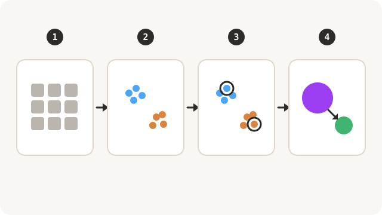

# Learning without labels

*Let a model learn the structure of the scan before showing it any answer key, then use it to produce labels.*

## The idea

Reliable labels are scarce and scans are huge. Self-supervised learning turns the problem around: the model first learns structure from raw data, with no human labelling every voxel.

## How it works

1. **Raw scan blocks**, with no labels at all.
2. **A self-supervised model** (the DINO family, here in 3D) learns to give similar internal representations to similar structures. That representation is called an embedding.
3. **A few expert examples** are then enough: if ink voxels form a recognisable group, many candidate labels follow.
4. **Distillation**: a student network learns to reproduce the output of an already trained, frozen teacher instead of a hand-made label.

*Numbers refer to the plate.*

## Why it matters here

The 3D ink model released for PHerc. Paris. 4 is guided by embeddings of this kind and by distillation from another ink model. Another trainer from the team learns four classes (background, vertical fibre, horizontal fibre, ink) with no ground-truth labels, from two frozen teachers. This is direction P-340 on our map.
