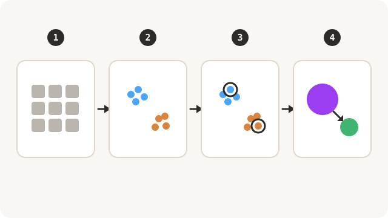

# Apprendre sans étiquettes

*Faire apprendre la structure du scan à un modèle avant de lui montrer le moindre corrigé, puis s'en servir pour fabriquer des étiquettes.*

## L'idée

Les corrigés fiables sont rares, les scans sont immenses. L'apprentissage auto-supervisé retourne le problème : le modèle apprend d'abord la structure des données brutes, sans qu'un humain étiquette chaque voxel.

## Comment ça marche

1. **Des blocs de scan bruts**, sans aucune étiquette.
2. **Un modèle auto-supervisé** (la famille DINO, ici en volume) apprend à donner des représentations internes proches à des structures qui se ressemblent. Cette représentation s'appelle un plongement.
3. **Quelques exemples d'expert** suffisent alors : si les voxels d'encre forment un groupe reconnaissable, on en tire beaucoup d'étiquettes candidates.
4. **La distillation** : un réseau élève apprend à reproduire la sortie d'un réseau professeur déjà entraîné et figé, plutôt qu'une étiquette faite à la main.

*Les numéros renvoient à la planche.*

## Pourquoi ça compte ici

Le modèle d'encre 3D publié pour PHerc. Paris. 4 est guidé par des plongements de ce type et par distillation depuis un autre modèle d'encre. Un autre entraîneur de l'équipe apprend quatre classes (fond, fibre verticale, fibre horizontale, encre) sans aucune étiquette de vérité terrain, à partir de deux professeurs figés. C'est la piste P-340 de notre carte.

## Le vocabulaire anglais

| Anglais | Français |
|---|---|
| *self-supervised learning* | apprentissage auto-supervisé |
| *embedding* | plongement : représentation interne |
| *teacher / student* | professeur / élève |
| *self-distillation* | auto-distillation |
| *frozen* | figé : dont les valeurs ne changent plus |
