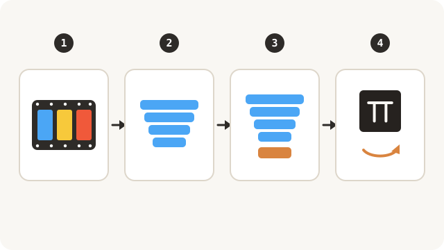

# Pretraining and transfer

*Start from a model that has already learned elsewhere, then adjust it to our data, instead of starting from scratch.*

## The idea

A model need not start from random values. It can reuse those found by another training run, on other data, and continue from there. This is transfer; the original run is called pretraining.

## How it works

1. **A model trained elsewhere**: for instance on video. A video and a scan volume are both three-dimensional data.
2. **The backbone** of that model, the part extracting shapes, is reused as is.
3. **A new head** is added for our question: is there ink?
4. **Fine-tuning**: training continues on our ink labels.

*Numbers refer to the plate.*

## Why it matters here

The six models that made PHerc. 1667 readable share such a backbone (ResNet3D-50, weights learned on the Kinetics-700 video set), followed by a 2D U-shaped decoder (K-11). In 2023 Youssef Nader adapted the fragment-winning models to scrolls: unsupervised pretraining on scroll data, then fine-tuning on fragment labels.
