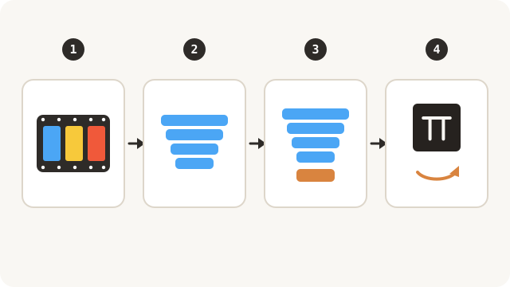

# Le pré-entraînement et le transfert

*Partir d'un modèle qui a déjà appris ailleurs, puis l'ajuster à nos données, au lieu de partir de zéro.*

## L'idée

Un modèle ne part pas forcément de valeurs tirées au hasard. On peut reprendre celles qu'un autre entraînement a trouvées, sur d'autres données, et continuer à partir de là. C'est le transfert ; l'entraînement d'origine s'appelle le pré-entraînement.

## Comment ça marche

1. **Un modèle entraîné ailleurs** : par exemple sur de la vidéo. Une vidéo et un volume de scan sont tous deux des données en trois dimensions.
2. **Le squelette** de ce modèle, la partie qui extrait les formes, est repris tel quel.
3. **Une nouvelle tête** lui est ajoutée pour notre question : y a-t-il de l'encre ?
4. **L'affinage** : on poursuit l'entraînement sur nos étiquettes d'encre.

*Les numéros renvoient à la planche.*

## Pourquoi ça compte ici

Les six modèles qui ont permis de lire PHerc. 1667 partagent un squelette de ce type (ResNet3D-50, valeurs apprises sur le jeu vidéo Kinetics-700), suivi d'un décodeur en U à plat (K-11). En 2023, Youssef Nader avait adapté aux rouleaux les modèles gagnants sur fragments : pré-entraînement non supervisé sur les données de rouleau, puis affinage sur les étiquettes des fragments.

## Le vocabulaire anglais

| Anglais | Français |
|---|---|
| *pretraining* | pré-entraînement |
| *backbone* | squelette |
| *fine-tuning* | affinage |
| *transfer* | transfert |
| *domain adaptation* | adaptation à un autre type de données |
