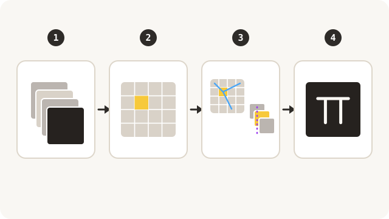

# TimeSformer

*A model designed for video, repurposed in 2023 to read the thickness of the papyrus as a sequence of images.*

## The idea

TimeSformer is a 2021 model by Gedas Bertasius, Heng Wang and Lorenzo Torresani, built to recognise what happens in a video. It uses no convolutions, the building block of U-shaped networks (K-11): everything relies on attention, a mechanism where each piece of the image looks at the others to decide what matters. The 2023 Grand Prize winners applied it to the scan: the layers of the surface volume (K-07) play the role of successive video frames.

## How it works

1. **A stack of layers** around the papyrus surface is treated as a short video: in the winners code, 26 layers of 64 pixels on a side.
2. **Each layer is cut into patches** of 16 pixels on a side.
3. **Divided attention**: each patch first looks at the other patches of its layer, then at the same place in the other layers. The model authors found this setting best, and the winning model uses it.
4. **As output**, an ink probability for the small square being looked at.

*Numbers refer to the plate.*

## Why it matters here

What the challenge says is consistent with the source: the Grand Prize page states that the sharpest images often came from a TimeSformer-based model, and the "64x64" caption matches the window size in the code. Two clarifications. The original model classifies whole videos; here it tells whether there is ink in a small square, an adapted use. And this code now sits in the `deprecated` folder of villa: the team current models (PHerc. 1667, 9 µm models) rely on convolutions, not on TimeSformer.
