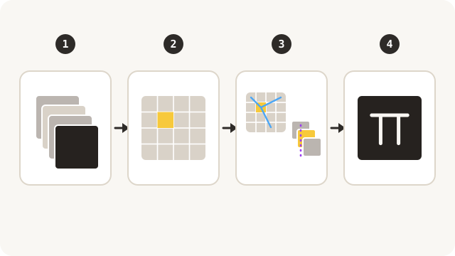

# TimeSformer

*Un modèle conçu pour la vidéo, détourné en 2023 pour lire l'épaisseur du papyrus comme une suite d'images.*

## L'idée

TimeSformer est un modèle de 2021, de Gedas Bertasius, Heng Wang et Lorenzo Torresani, fait pour reconnaître ce qui se passe dans une vidéo. Il n'utilise aucune convolution, la brique des réseaux en U (K-11) : tout repose sur l'attention, un mécanisme où chaque morceau de l'image regarde les autres pour décider ce qui compte. Les gagnants du Grand Prix 2023 l'ont appliqué au scan : les couches du volume de surface (K-07) jouent le rôle des images successives d'une vidéo.

## Comment ça marche

1. **Une pile de couches** autour de la surface du papyrus est traitée comme une courte vidéo : dans le code des gagnants, 26 couches de 64 pixels de côté.
2. **Chaque couche est découpée en carreaux** de 16 pixels de côté.
3. **L'attention divisée** : chaque carreau regarde d'abord les autres carreaux de sa couche, puis le même endroit dans les autres couches. C'est le réglage que les auteurs du modèle trouvent le meilleur, et celui du modèle gagnant.
4. **En sortie**, une probabilité d'encre pour le petit carré regardé.

*Les numéros renvoient à la planche.*

## Pourquoi ça compte ici

Le discours du défi est cohérent avec la source : la page du Grand Prix dit que les images les plus nettes venaient souvent d'un modèle fondé sur TimeSformer, et la légende « 64x64 » correspond à la taille de fenêtre du code. Deux précisions. Le modèle d'origine classe des vidéos entières ; ici il sert à dire s'il y a de l'encre dans un petit carré, ce qui est un usage adapté. Et ce code est aujourd'hui rangé dans le dossier `deprecated` de villa : les modèles actuels de l'équipe (PHerc. 1667, modèles à 9 µm) reposent sur des convolutions, pas sur TimeSformer.

## Le vocabulaire anglais

| Anglais | Français |
|---|---|
| *attention* | attention : chaque morceau pondère les autres |
| *divided space-time attention* | attention divisée : dans l'image, puis dans le temps |
| *frame* | image d'une vidéo ; ici, une couche du volume |
| *patch* | carreau découpé dans une image (K-12) |
| *convolution-free* | sans convolution |
